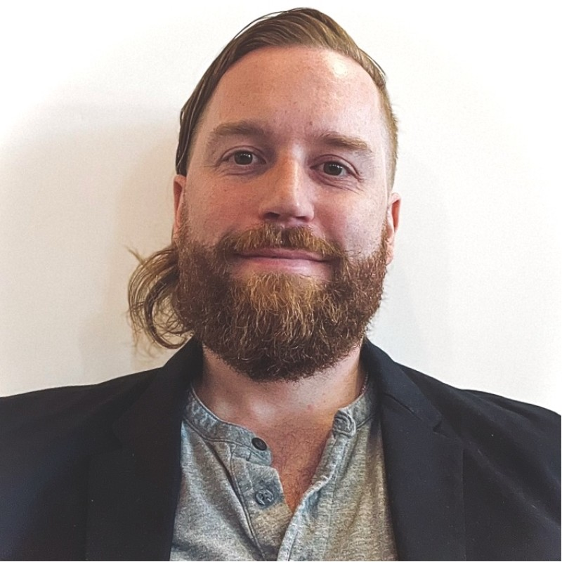
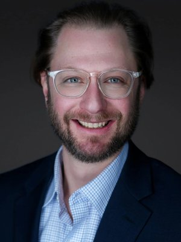

Thank you for visiting our Governance page. Please meet our leadership and
review our governance and other documents in the [listing
below](#governance-document-archive).

## Leadership

### President and CEO Matthew A. Turner, PhD

{.leadership-photo}

Dr. Matt Turner is the founder, president, and CEO of the Generation of
Participation in Democracy. He helped co-found Instituto Dourados led by [Dr.
Rezende](#vice-president-and-chief-accountability-officer), and in partnership
with our Indigenous partners. Dr. Turner leads the group effort to develop the
_Future Shaper's Curriculum_ so that it meets our partner students' needs, fits
their interests, and is well-matched to their current capacities to avoid
boredom or discouragement.

Dr. Turner leads several GPD initiatives as CEO. He leads the recruitment,
founding, and development of new GPD institutes who will put GPD research into
action using tools from the Future Shaper toolkit. He provides support to GPD
institutes on how to organize and grow their organizations, and teaching
support for the Future Shaper's Curriculum in the classroom or community.

He also leads software development for GPD, creating new and consolidating
several existing open source software projects under the common banner of the
_Sustained Inference_ brand. Sustained Inference unites GPD's open software
products with computers and other products developed and sold by
by Dr. Turner's company, [SubtleTea Solutions](https://subtleteasolutions.com).

[Dr. Turner's website](https://mat.phd)

### Vice President and Chief Accountability Officer  Izabela Mauricio de Rezende, PhD

{.leadership-photo}

Dr. Iza Rezende is co-founder, Vice President, and the Chief Accountability Officer of the
Generation of Participation in Democracy.

Dr. Rezende leads research and academic initiatives at GPD to deepen our impact
across sectors and multiply our impact over time through intentional, clever,
and humane cultural accumulation. She is the Founder and Director of
GPD's Flagship Institute, [Instituto Dourados](#instituto-dourados).

As Chief Accountability Officer, Dr. Rezende confirms, and corrects if
necessary, GPD projects and plans so that they truly serve historically
marginalized folks first and foremost, and promote the greater good overall.

Dr. Rezende is a virologist and Research Scientist at the Stanford University
School of Medicine, leading interdisciplinary studies on infectious disease
epidemiology and virus evolution. Her work bridges real-time genetic
identification of what is making people sick with public health intervention
strategy design to better protect vulnerable populations.

Dr. Rezende received her PhD in Microbiology and Virology from the Universidade
Federal de Minas Gerais, and a MS in Infectious Diseases and BS in Biology from
the Universidade Federal de Juiz de Fora in the state of Minas Gerais, Brazil.

[Dr. Rezende on LinkedIn](https://www.linkedin.com/in/izabela-rezende/)

### Treasurer Joshua Rueckheim, MBA

{.leadership-photo}

Joshua Rueckheim oversees book keeping, develops controls and ensures
enforcement, and assists with structuring and executing forecasts and other
business processes. Mr. Rueckheim applies his decades of expertise in business
management to ensure the financial integrity of the GPD Network's
organizations.

Mr. Rueckheim is currently Finance Director for the Philadelphia Hospitality
Investment Levy and for [Alta Management
Services](https://www.altamsi.com/our-team/). Before joining Alta, Mr.
Rueckheim worked for Mariott International for 10 years in various finance and
accounting roles.

[Mr. Rueckheim on
LinkedIn](https://www.linkedin.com/in/joshua-rueckheim-96241226/)

## Governance Document Archive

Please select a document of interest from the listing below.

