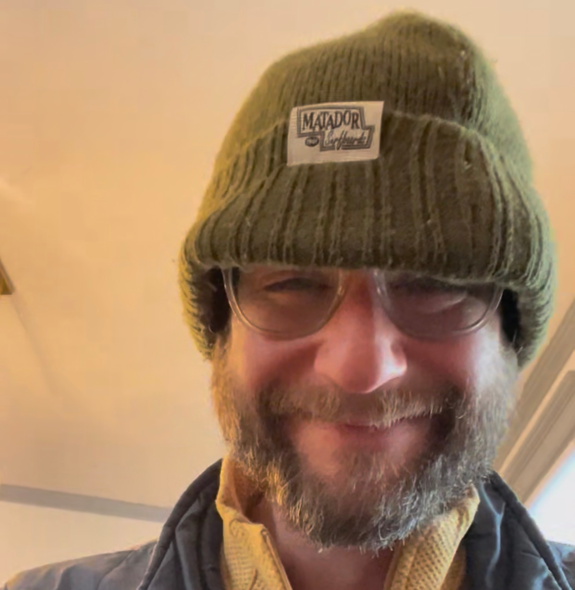

The GPD Network serves as the shared leadership community for a growing
ecosystem of affiliated organizations and projects. Cumulus provides a common
forum in which leaders coordinate strategy, stewardship, and long-term direction
while each participating organization retains its own legal identity, governing
documents, and mission.

This shared governance task force's mission is to
found the organizational infrastructure to ensure affiliated organizations
achieve decades of sustainable business based on transparency, continuity, and
compliance.

As the ecosystem evolves, its governance will evolve with it. The structures
described here are intentionally lightweight and are expected to adapt as new
leaders, organizations, and communities join the GPD Network.

We publish our governance documents, meeting minutes, and major decisions as
part of our commitment to openness, institutional learning, and responsible
stewardship. A [listing of our governing
documents](#governance-document-archive) follows the presentation of our board
of directors.

## Executive Leadership/Board of Directors

Our directors serve identical roles at both GPD and STS. This is temporary
scaffolding as we continue to identify and fill key roles.

The current board act as Community executive leadership for the foreseeable
future. Specific roles within organizations will be adjusted as necessary for
success.

### President Matthew A. Turner, PhD

{.member-photo}

Dr. Matt Turner is the Founder and President of the Generation of Participation in
Democracy and SubtleTea Solutions. His mission is to make science work for
scientists, in pursuit of a sustainable economic system based on _enough_
instead of our current system based on _never enough_.

In practice this means he focuses on developing organizations and principles to
help innovative basic research live up to its full potential for positive real
world impact.

In a typical day, Dr. Turner might work on new coursework and writing, publish
new content to be included in a forthcoming book, _Quantitative Social Science
for Sustainable Futures_, creating new computer hardware and software, or
lead a board meeting.

[Dr. Turner's website](https://mat.phd)

### Secretary Izabela Mauricio de Rezende, PhD

{.member-photo}

Dr. Izabela Rezende is the Founder and Director of Instituto Dourados, the
inaugural Flagship Institute of the GPD.

Dr. Rezende will ensure that all members of the GPD Network deliver on our
promise to serve the Indigenous peoples of Dourados, and improve public health
and sustainability policy outcomes in general.

She will ensure our for-profit affiliate, SubtleTea Solutions, contributes
to the greater good while maintaining its focus making excellent products for
our customers and making sustainability lucrative for investors.

[Dr. Rezende on LinkedIn](https://www.linkedin.com/in/izabela-rezende/)

### Treasurer Joshua Rueckheim, MBA

{.member-photo}

Joshua Rueckheim oversees book keeping, develops controls and
ensures enforcement, and assists with structuring and executing
forecasts and other business processes. Mr. Rueckheim
applies his decades of expertise in business management to ensure the
financial integrity of the GPD Network's organizations.

Mr. Rueckheim is currently Finance Director for the Philadelphia Hospitality
Investment Levy and for [Alta Management
Services](https://www.altamsi.com/our-team/). Before joining Alta, Mr. Rueckheim
worked for Mariott International for 10 years in various finance and
accounting roles.

[Mr. Rueckheim on LinkedIn](https://www.linkedin.com/in/joshua-rueckheim-96241226/)

## Governance Document Archive

Please select a document of interest from the listing below.

