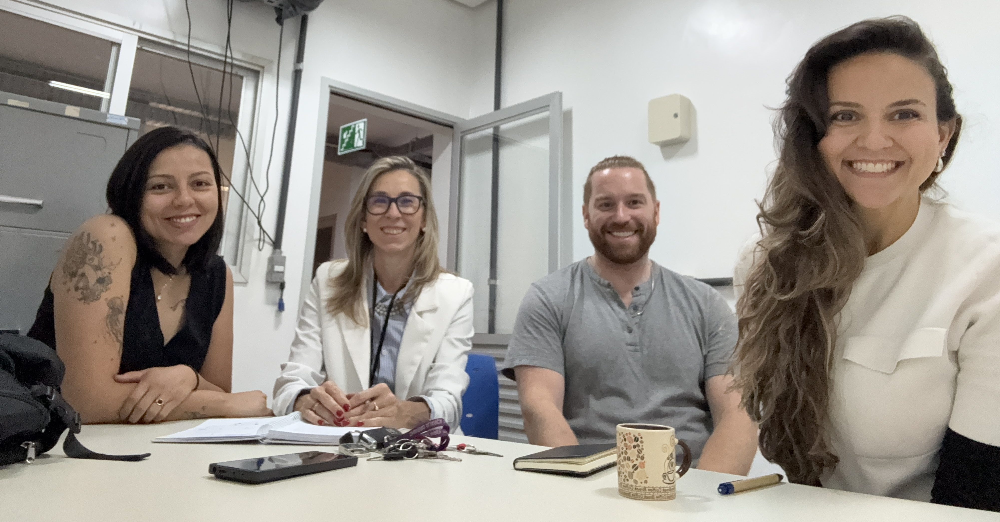
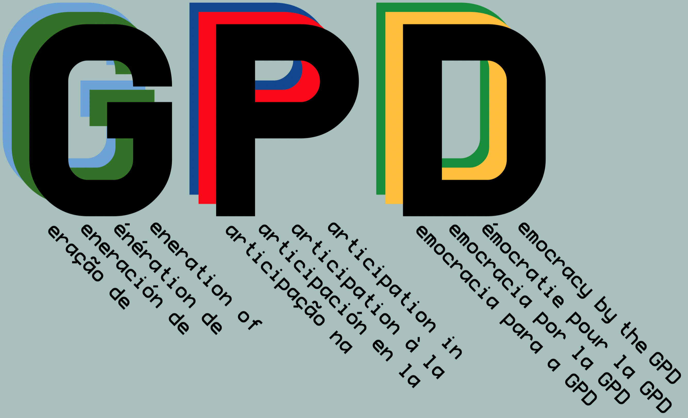

# The Generation of Participation in Democracy

## Research In Action For Sustainable Futures

**Public Benefit Mission.** The Generation of Participation in Democracy (GPD)
is a tax-exempt 501(c)(3) public charity and non-governmental organization.

We put education and research into action to help communities enhance their own
autonomy, on their own, and accelerate capacity building.

If you would like to support us, please consider supporting our 2027 educational program by [helping send laptops and instructors to Indigenous students in Brazil](https://www.zeffy.com/en-US/donation-form/health-decisions-should-be-in-the-hands-of-local-communities-help-us-develop-the-tools-and-programs-to-make-it-happen)!

{width=460px .lightbox}

**GPD IRS Employer Identification Number (EIN): 41-4992916.**

Look up our IRS registration with this [IRS search tool](https://apps.irs.gov/app/eos/).

## _Research In Action_ Accelerator Program

Our Research In Action accelerator program helps founders launch nonprofit
research institutes that put actionable insight first, with rigor a close but
distinct second.

Prospective accelerator participants must first demonstrate how their institute
will spark self-sustaining capacity building that can continue indefinitely,
even if the institute and community part ways.

### Instituto Dourados

Our Flagship Institute, [Instituto Dourados](https://institutodourados.org),
develops and deploys public health education and monitoring systems in
collaboration with Indigenous communities, integrating epidemiology, social
science, and multilingual knowledge sharing.

### Next Up, Instituto _You_

You too could one day build an institution like Instituto Dourados by
participating in the program. We review proposals on a rolling basis, depending
on interest. Please contact GPD leadership to inquire about your idea.

- President & CEO, [Dr. Matthew A. Turner](mailto:matt@gpd.network)
- Vice President & Director of Instituto Dourados, [Izabela Mauricio de
  Rezende](mailto:iza@institutodourados.org)

## Education For Future Shapers

Our _Future Shaper's Curriculum_ is being developed in partnership with the
Guateka Academy Secondary School in the Dourados Indigenous Reservation in the
state of Mato Grosso do Sul, Brazil, facilitated by Instituto Dourados.

{width=440px .lightbox}

The curriculum teaches essentials from philosophy, mathematics, programming,
efficient computing, social science, leadership and project management skills
for current and future _future shapers_ worldwide. Business, policy making,
government, and even just daily life have become complex without precedent.
The future's most effective leaders will boast a much deeper expertise across
a much broader collection of subjects than is expected of anyone today.

Those completing the course will be able to build new community-strengthening
technologies, such as multi-channel emergency alert and community notification
systems, which one community leader suggested as a student project.

We have also brainstormed AI-enabled edge devices that could run on solar
energy. These devices could run local, highly-specialized, and therefore
highly-efficient, translation devices with a camera, a speaker, and a
microphone, so the user could interact with it using their voice to understand
their information, and no data need ever to travel to the global Internet, and
little personal health data need be exposed at all.

Many community members cannot read and do not know Portuguese, only their
Indigenous home language. Community leaders have told us that AI-generated
audio and video aids that adapt in real-time to user questions and concerns
could be life-changing for Indigenous peoples facing scary healthcare
emergencies, surgeries, and other healthcare events.

No digitization of languages spoken on the Reservation are available. Current
and future students could help design and perform the initial supervised
learning stage providing expert instruction to the AI system to seed the model.

## A Sustainability VIBE To Boost Participation

Our approach to boosting democratic participation is to raise the global
**Sustainability _VIBE_**. That is, we create tools and systems to support
_**V**ibrant **I**nstitutions_ that ensure everyone's
_**B**asic needs are met_. Only when basic needs are met can people be expected
contribute to _**E**nvironmental protection_.
Future generations need a healthy environment for a good life,
liberty, and the pursuit of happiness, free from excessive risk and uncertainty.

## Transparency

Meaningful democratic participation requires transparency.
GPD operates under a principle of radical transparency for financial decisions and
[governance](governance.qmd).

**To meet our board of directors or review our organizing documents and other accountability information**, please visit our [Governance](governance.qmd) page.

**Inquiries:** [transparency@gpd.network](mailto:transparency@gpd.network)

 

{#anchor width=390px fig-align="center"}

