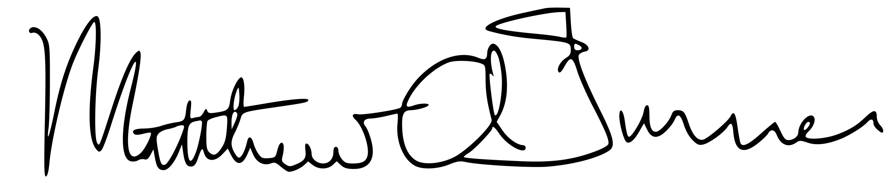

<!-- # Generation of Participation in Democracy {#brand-title} -->
<h1 id="brand-title">Generation of Participation in Democracy</h1>

<h2 id="brand-subtitle">Sustainable Operating Systems  
                        for Sustainable Futures</h2>

**Public Benefit Mission.** GPD is a tax-exempt 501(c)(3) public charity and
non-governmental organization that serves others by helping them use science,
technology, and education to regain autonomy that might have been lost,
especially among historically marginalized peoples. _**IRS Employer
Identification Number: 41-4992916.**_

**Sustainability.** We align our mission with the United Nations' [Sustainable
Development Goals](https://sdgs.un.org/goals), focusing on developing and
securing the foundations of participation for the 21st century.
Our system for sustainability identifies how vibrant institutions help people
participate by ensuring everyone's needs are met.
Expanded, coordinated participation could be a surprisingly sturdy bulwark
against risk and uncertainty.

**Education.** Our _agile_ educational practices put
synthesis and application first, and exhaustive theory second. Education
archives and spreads word about _why_ certain practices are more beneficial,
and _how_ to practice them. Education provides the foundation for invention.

**Transparency.** Meaningful democratic participation requires transparency.
GPD operates under a principle of radical transparency in most cases.
True transparency in democracies requires an educated population that can
analyze business data and make use of information supporting transparency.

## A Sustainability VIBE to Boost Participation

Our approach to boosting democratic participation amounts to raising the global
**Sustainability _VIBE_**. We create tools and systems to accelerate the
creation of _**V**ibrant **I**nstitutions_ that ensure everyone's
_**B**asic needs are met_. Only when basic needs are met can people be expected
to collectively protect our _**E**nvironment_.
We must protect our environment to guarantee it is sustained for our children,
their children and grandchildren and ever on down to future generations.

In more formal language, our mission is to increase informed democratic
participation by means of building _sustainable capacity_, _individual
sovereignty_, and _collective autonomy_. This means technical, social, and
political capacities exist within a group that can be readily leveraged to
provide goods and services for that group. It further means that individuals are
not forced to comply or conform, but instead choose to participate out of
authentic self interest.

## Instituto Dourados, our First _Flagship Institute_

Our first Flagship Institute, [Instituto Dourados](https://institutodourados.org), develops and deploys public health systems in collaboration with Indigenous communities, integrating epidemiology, social science, and multilingual knowledge sharing.

To inquire about participating in the Flagship Accelerator program, please
contact [GPD President Matt Turner](mailto:matt@gpd.network) or [GPD Secretary Iza Rezende](mailto:iza@gpd.network).

**Organizing Documents:** See our [Governance Documents page](governance.qmd).

**Transparency inquiries:** [transparency@gpdamericas.org](mailto:transparency@gpdamericas.org)

**Download our 501(c)(3) exemption approval letter:**
[GPD_501c3_Approval.pdf](files/GPD_501c3_Approval.pdf).

 
 

{#anchor width=390px fig-align="center"}

 

### Founder’s Statement

GPD is built to move from theory to implementation—combining research, infrastructure, and education to support sustainable futures across the Americas.

  <em>In solidarity and service,</em>

  <strong>Matt Turner, PhD</strong>

  Founder &amp; Architect 
  GPD Américas

  <a href="mailto:matt@mat.phd">Contact</a>

